<div align="center">

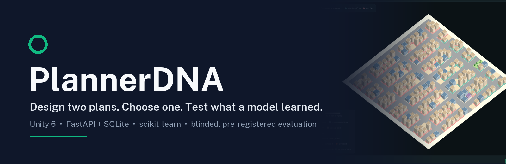

<br>

**A local-first 3D urban-design sandbox that learns a personal, explainable preference model from explicit A/B planning choices — and then tests it with a pre-registered, blinded protocol.**

<br>

[](https://unity.com/)
[](PlannerDNA_Unity/PlannerDNA_Unity/Assets/PlannerDNA/Scripts)
[](PlannerDNA_Unity/PlannerDNA_Unity/Packages/manifest.json)
[](backend)
[](backend/app)
[](docs/data-dictionary.md)
[](docs/ml-protocol.md)

[](backend/tests)
[](PlannerDNA_Unity/PlannerDNA_Unity/Assets/PlannerDNA/Tests/EditMode)
[](PlannerDNA_Unity/PlannerDNA_Unity/Assets/PlannerDNA/Tests/PlayMode)
[](docs/architecture.md)
[](docs/research-limitations.md)
[-0F172A)](docs/ml-protocol.md)

[**Demo video**](deliverables/video/PlannerDNA.mp4) ·
[**Technical paper (PDF)**](deliverables/PlannerDNA_Technical_Paper.pdf) ·
[**System overview**](deliverables/PlannerDNA_System_Overview.md) ·
[**Start here**](docs/START_HERE.md) ·
[**Runbook**](docs/runbook.md)

</div>

---

<div align="center">
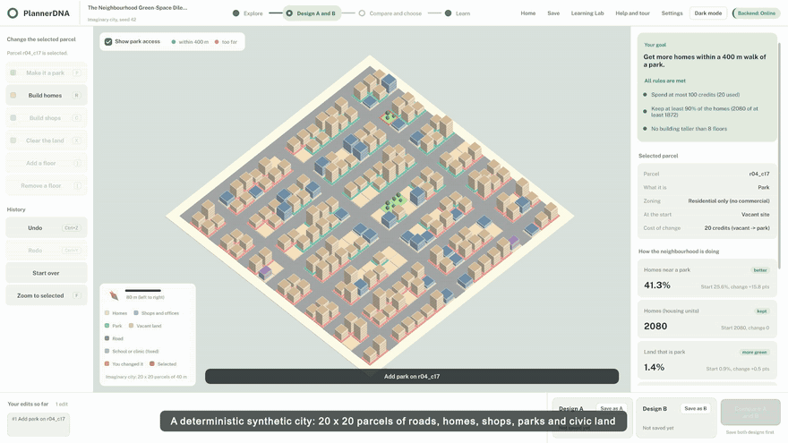
<br>
<sub>Seed-42 neighbourhood, 20 × 20 parcels (800 m × 800 m), dark theme. Full narrated walkthrough: <a href="deliverables/video/PlannerDNA.mp4"><code>deliverables/video/PlannerDNA.mp4</code></a> (1:57, 1080p).</sub>
</div>

---

## Contents

- [Why PlannerDNA](#-why-plannerdna)
- [Highlights](#-highlights)
- [Screenshots](#-screenshots)
- [How it works](#-how-it-works)
- [System architecture](#-system-architecture)
- [The sandbox: metrics and rules](#-the-sandbox-metrics-and-rules)
- [The model](#-the-model)
- [The blinded evaluation protocol](#-the-blinded-evaluation-protocol)
- [Results](#-results)
- [Engineering and integrity](#-engineering-and-integrity)
- [Getting started](#-getting-started)
- [Testing](#-testing)
- [Repository layout](#-repository-layout)
- [Documentation and deliverables](#-documentation-and-deliverables)
- [Limitations and ethics](#-limitations-and-ethics)
- [Citation](#-citation)
- [Acknowledgements](#-acknowledgements)

---

## 🧭 Why PlannerDNA

Planning students are taught to weigh trade-offs — park access against housing, cost against
displacement — but rarely get to see *which* trade-offs they actually favour when forced to choose.

PlannerDNA turns that into a short, repeatable exercise:

1. **Design** two alternative plans for the same generated neighbourhood.
2. **Choose** the one you prefer (or call it a tie). That explicit choice is the *only* label.
3. **Learn** a small, transparent pairwise model of your choices — with uncertainty, cross-validation against simple rules, and ranked suggestions.
4. **Test** the frozen model on cities it has never seen, with predictions sealed *before* you choose.

> [!IMPORTANT]
> The weights describe **statistical associations with the pairs that were compared** — not
> motives, values or expertise. The app says so on screen, in the paper and in every export.

---

## ✨ Highlights

| | Feature | What it means |
|---|---|---|
| 🏙️ | **Deterministic procedural city** | SplitMix64-seeded 20 × 20 parcel grid with a connected road network; the same seed always gives the same city (pinned by unit tests). |
| 📏 | **Real metrics, recomputed every edit** | Housing capacity, 400 m road-network park access (multi-source BFS), park share, cost and lost original housing. |
| 🚦 | **Hard planning rules** | Budget ≤ 100 credits, housing ≥ 90 % of baseline, ≤ 8 floors, roads and civic parcels protected. Refused edits explain why. |
| ↩️ | **Exact undo / redo** | Every edit is reversible; saved designs are snapshots, not diffs. |
| 🅰️🅱️ | **Explicit A/B choice is the only label** | Clicks, dwell time and undo activity are never treated as preferences. |
| 📈 | **Pairwise logistic (Bradley–Terry) model** | Five interpretable features, mirrored rows, no intercept, L2 — position cannot be learned. |
| 🎯 | **Uncertainty and diagnostics** | 200-resample city-level bootstrap, leave-one-city-out CV against four transparent rules. |
| 🛑 | **Readiness gates** | Training *refuses* rather than guesses below 10 informative comparisons, 2 cities and 2 trade-off directions. |
| 🔒 | **Blinded, pre-registered test** | SHA-256 seals with nonces, server-held seed, randomised sides, swapped repeats, self-verifying report. |
| 🧾 | **Tamper-evident storage** | Models are checksummed JSON (never pickle); the backend rebuilds every design from its snapshot and rejects mismatches. |
| 🌗 | **Student-friendly UI** | Home screen, 13-step guided tour, four-step journey bar, light and dark themes, Public Sans typography. |
| 🏠 | **Local-first** | Unity talks to a FastAPI backend on `127.0.0.1:8765`. No cloud, no accounts, no telemetry. |

---

## 🖼️ Screenshots

<table>
  <tr>
    <td width="50%">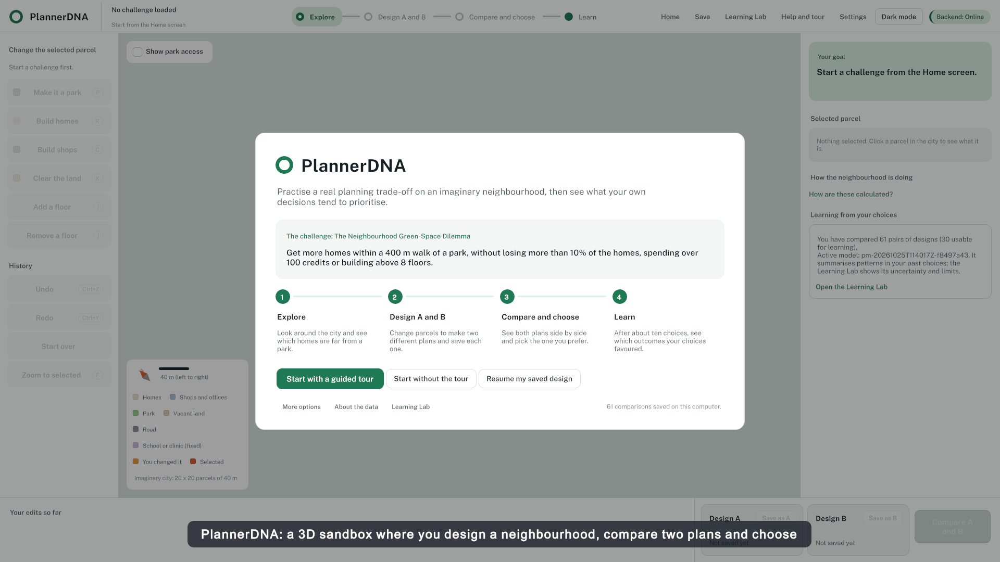<br><sub><b>Home.</b> The challenge, the rules and the four-step journey.</sub></td>
    <td width="50%">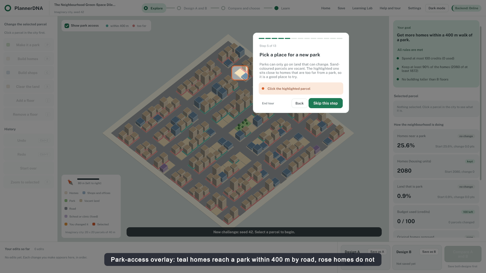<br><sub><b>Guided tour.</b> 13 spotlight steps that wait for the real action.</sub></td>
  </tr>
  <tr>
    <td>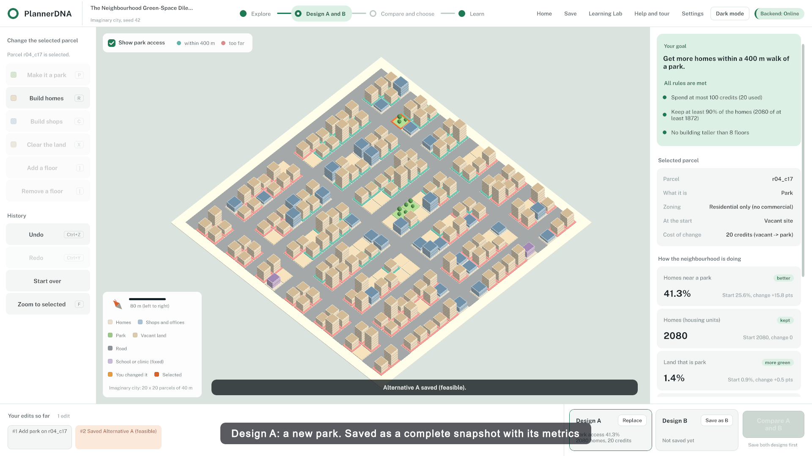<br><sub><b>Design A.</b> Live metrics and green/red rule indicators after every edit.</sub></td>
    <td>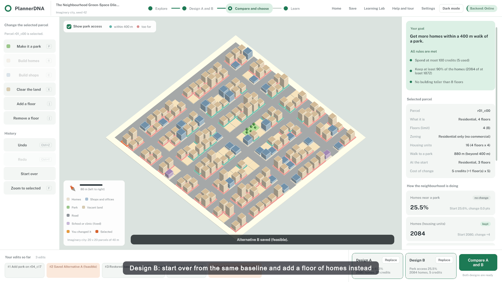<br><sub><b>Design B.</b> A different trade-off from the same baseline.</sub></td>
  </tr>
  <tr>
    <td>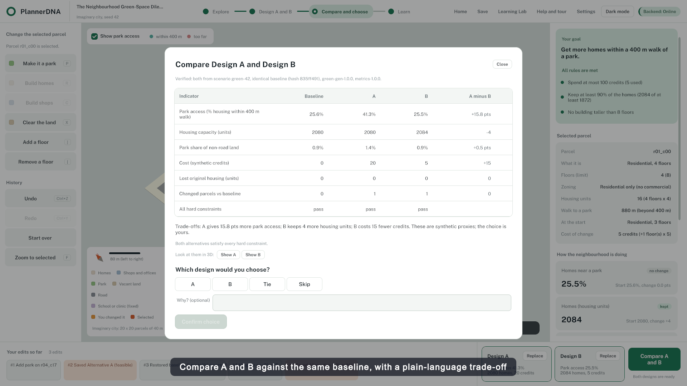<br><sub><b>Compare and choose.</b> A, B, tie or skip, with an optional reason.</sub></td>
    <td>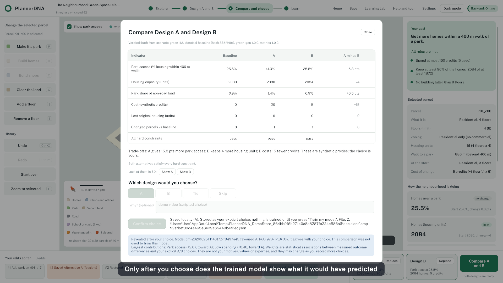<br><sub><b>Reveal.</b> The model's prediction appears only <i>after</i> the choice.</sub></td>
  </tr>
  <tr>
    <td>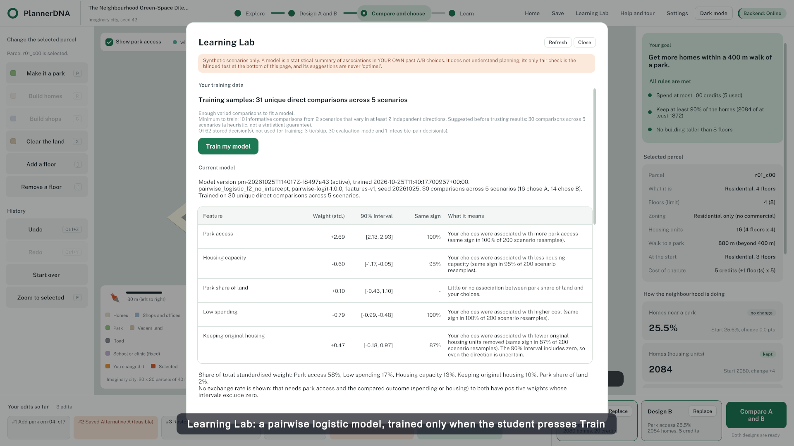<br><sub><b>Learning Lab.</b> Standardised weights with 90 % bootstrap intervals.</sub></td>
    <td>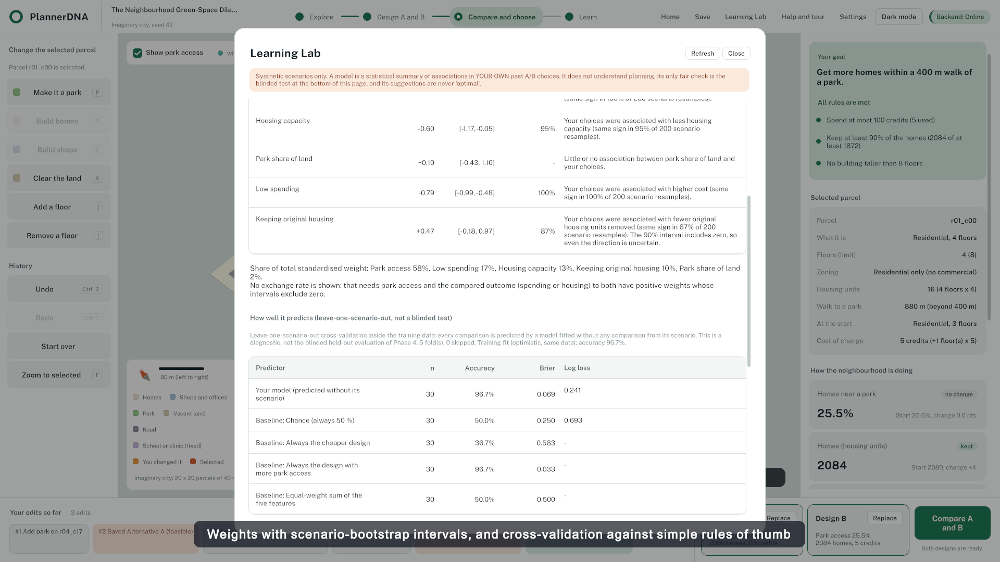<br><sub><b>Diagnostics.</b> Leave-one-city-out accuracy, Brier and log loss vs. rules.</sub></td>
  </tr>
  <tr>
    <td>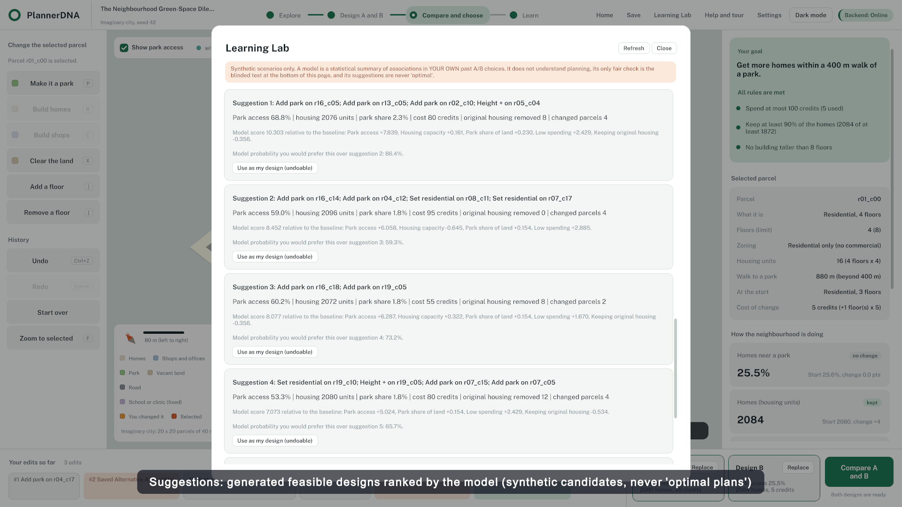<br><sub><b>Suggestions.</b> Verified synthetic candidates ranked by model utility.</sub></td>
    <td>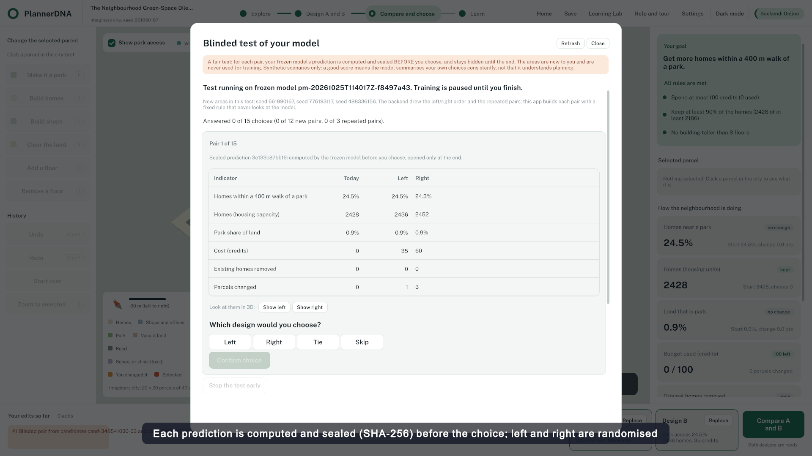<br><sub><b>Blinded test.</b> The prediction is sealed; only its fingerprint is shown.</sub></td>
  </tr>
  <tr>
    <td>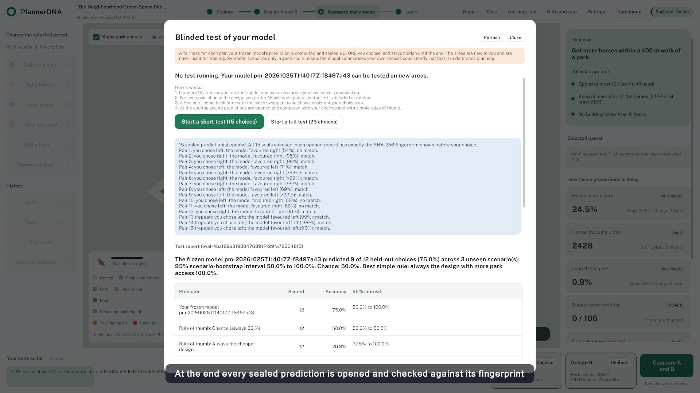<br><sub><b>Reveal.</b> Every seal is re-hashed and checked against its stored prediction.</sub></td>
    <td>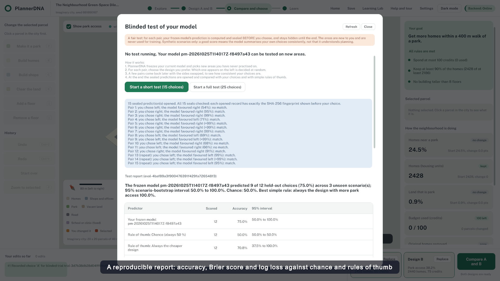<br><sub><b>Report.</b> Model vs. five baselines, consistency and side bias.</sub></td>
  </tr>
</table>

---

## 🔁 How it works

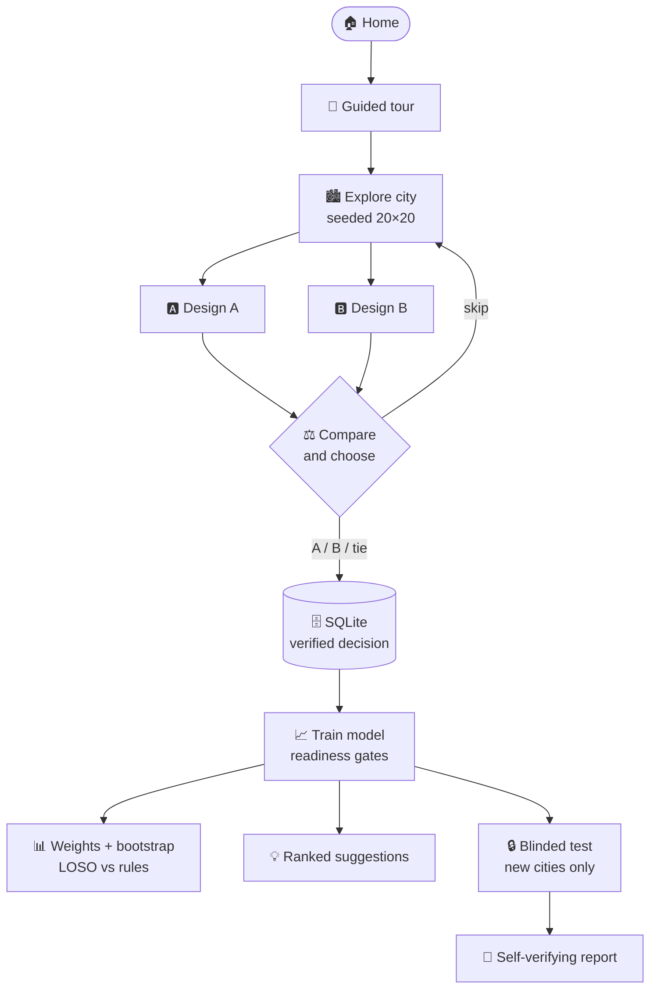

Each design is summarised by five features, each a **difference from the baseline city**:

| Feature | Higher means |
|---|---|
| `delta_access_fraction` | more homes within a 400 m walk of a park |
| `delta_housing_fraction` | more housing capacity |
| `delta_park_share_fraction` | more park land |
| `negative_budget_fraction` | lower cost |
| `negative_lost_housing_fraction` | fewer original homes removed |

<p align="center">
  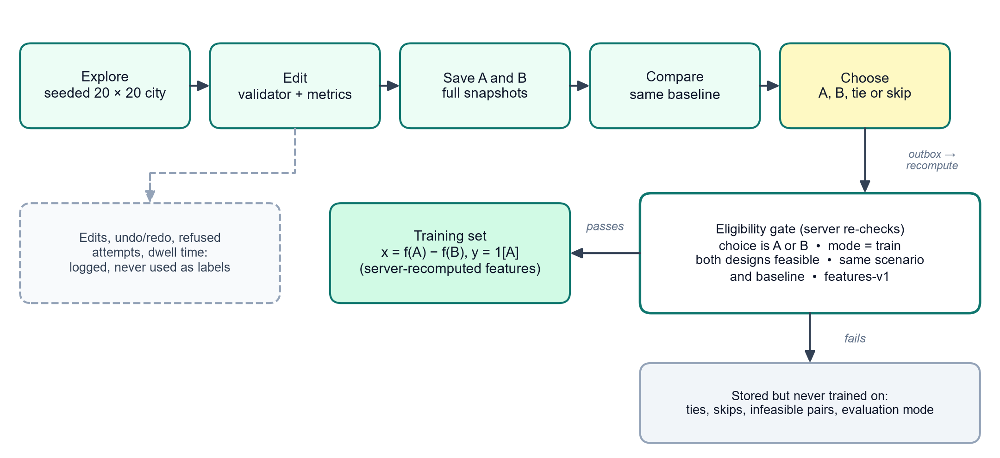<br>
  <sub>From two designs to one verified training row. Only explicit choices between two <i>feasible</i> designs from the same city become labels.</sub>
</p>

---

## 🏗️ System architecture

<p align="center">
  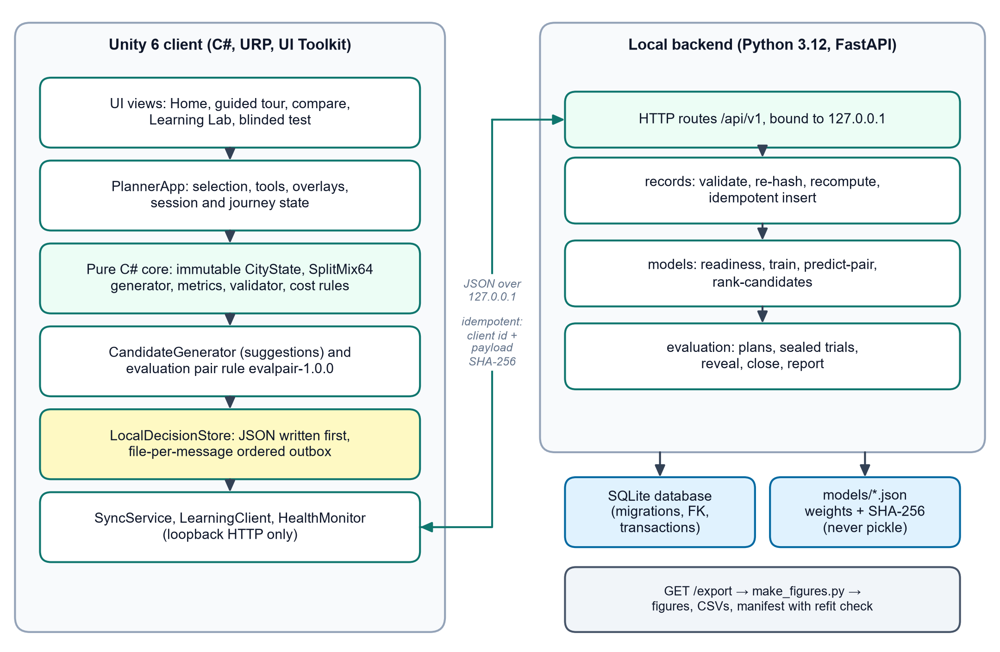
</p>

| Layer | Technology | Responsibility |
|---|---|---|
| **Client** | Unity 6000.6.7f1, C#, UI Toolkit (UXML/TSS), URP 17.6 | City generation, editing, live metrics, rule checks, undo/redo, comparison UI, Learning Lab, blinded-test UI, offline queue. |
| **Shared core** | Pure C# (`PlannerDNA.Core`) | Deterministic generator, metric engine, validator, candidate generator — no `UnityEngine` dependency, fully unit-tested. |
| **Transport** | HTTP/JSON on `127.0.0.1:8765` | Versioned DTOs; Unity falls back to a local store and syncs when the backend returns. |
| **API** | FastAPI + Pydantic | Re-verifies every design (snapshot → metrics → features → content hash) before accepting it. |
| **Storage** | SQLite (WAL, migrations) | Sessions, designs, decisions, refused edits, models, evaluation plans, seals and reports. |
| **Learning** | NumPy, SciPy, scikit-learn | Pairwise logistic regression, bootstrap, LOSO, readiness checks, candidate ranking. |
| **Artifacts** | Checksummed JSON | Model files with data fingerprint in the version id; reloaded and hash-checked on every prediction. |
| **Research tools** | matplotlib, reportlab, python-docx | Publication figures from exports, the technical paper and the carousel PDF. |

More: [`docs/architecture.md`](docs/architecture.md) · [`docs/data-dictionary.md`](docs/data-dictionary.md)

---

## 📐 The sandbox: metrics and rules

All metrics (`metrics-1.0.0`) are recomputed from the full city state after every edit — in Unity
for feedback, and again in the backend for trust.

| Metric | Definition |
|---|---|
| Housing capacity | Sum over residential parcels of floors × 4 units (a capacity proxy, not people) |
| Park access | Share of housing units whose road walk to a park is ≤ 400 m (multi-source BFS over road cells, no diagonals) |
| Park share | Park parcels as a share of non-road parcels |
| Cost | Sum over parcels of a fixed baseline-to-current cost table (restoring a parcel costs 0) |
| Lost original housing | Units removed from parcels that were residential at baseline (a displacement proxy) |

<p align="center">
  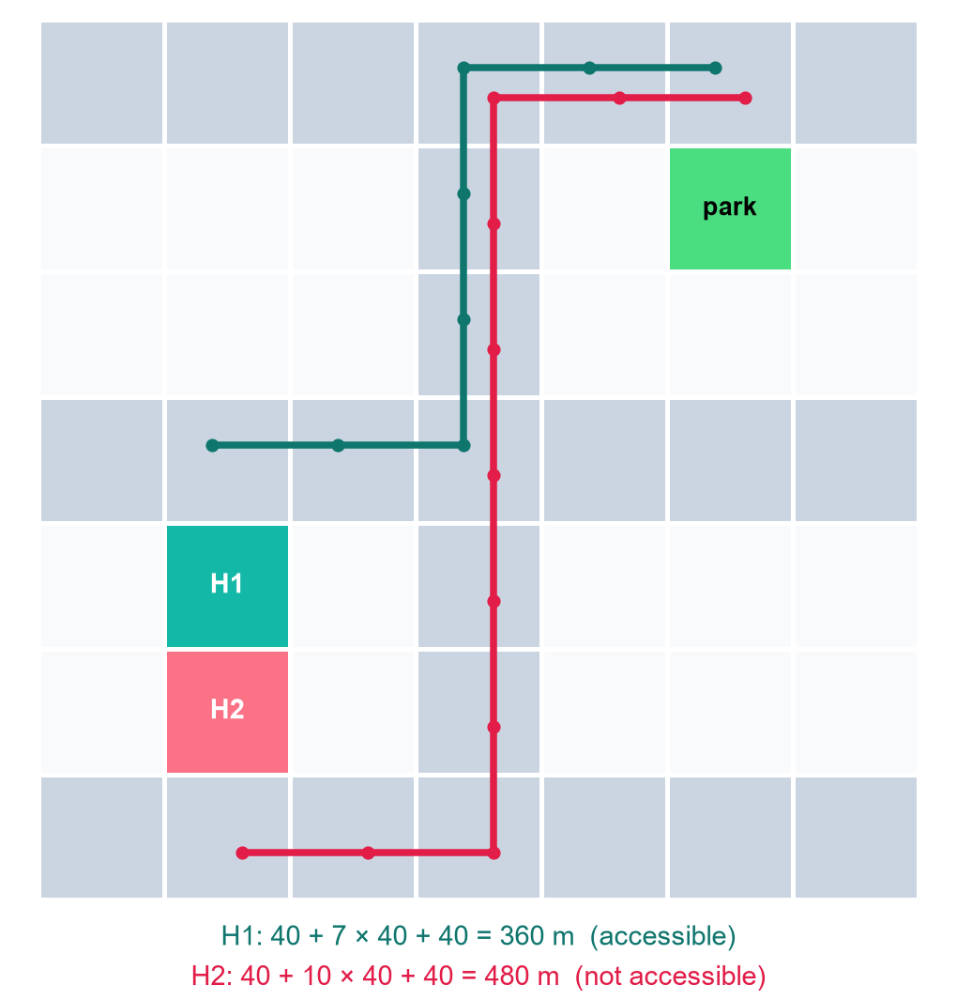<br>
  <sub>Park access is measured along the road network, not as the crow flies.</sub>
</p>

| Hard rule | Limit |
|---|---|
| Budget | ≤ 100 synthetic credits |
| Housing | ≥ 90 % of baseline capacity |
| Height | ≤ 8 floors |
| Protected | Roads and civic parcels cannot be edited |

Infeasible designs can be saved for discussion but are **never** used as training data.
Full formulas and the cost table: [`docs/scenario-and-metrics.md`](docs/scenario-and-metrics.md).

---

## 🧠 The model

A **pairwise logistic regression** in the Bradley–Terry family. With $f(\cdot)$ the five-feature
vector and $w$ the learned weights:

```math
P(A \succ B) \;=\; \sigma\!\big(w^{\top}\,[\,f(A) - f(B)\,]\big), \qquad \sigma(z) = \frac{1}{1 + e^{-z}}
```

Each choice is added twice, once mirrored, so that screen position cannot be learned:

```math
P(A \succ B) + P(B \succ A) = 1
```

The weights minimise the L2-penalised log loss over the $2n$ mirrored rows, with no intercept and
features scaled by their root-mean-square (no centring):

```math
\hat w \;=\; \arg\min_w \; \frac{1}{2C}\lVert w\rVert_2^2 \;-\; \sum_{i=1}^{2n} \Big[\, y_i \log \sigma(w^{\top}x_i) + (1-y_i)\log\big(1-\sigma(w^{\top}x_i)\big) \Big], \qquad C = 1
```

| Setting | Value |
|---|---|
| Estimator | scikit-learn `LogisticRegression(fit_intercept=False, C=1.0, solver="lbfgs")`, fixed seed |
| Scaling | RMS per feature, no centring → weights are log-odds per typical training difference |
| Uncertainty | 200 city-level (cluster) bootstrap refits → 90 % interval and sign agreement |
| Diagnostics | Leave-one-city-out CV vs. chance, *cheaper*, *more park access*, *equal-weight sum* |
| Readiness | ≥ 10 informative comparisons, ≥ 2 cities, ≥ 2 independent trade-off directions; *Exploratory* below 30 comparisons / 5 cities |
| Storage | JSON artifact + SHA-256; version id embeds a fingerprint of the training data |
| Suggestions | Up to 30 seeded feasible candidates, re-verified by the backend, ranked by utility $w^{\top} f$ — labelled *synthetic candidates, never optimal plans* |

<p align="center">
  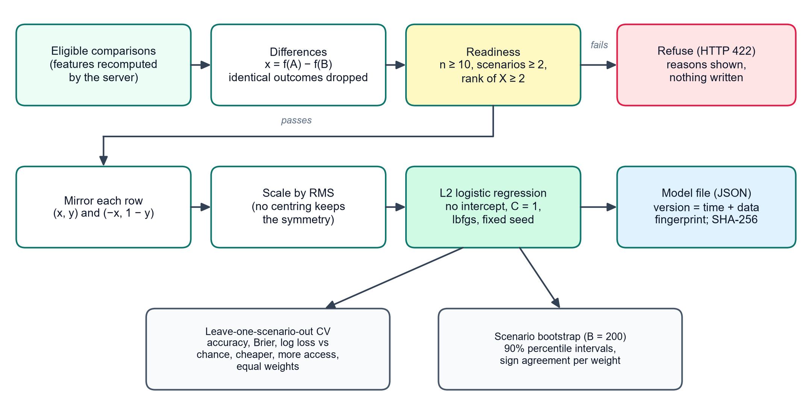<br>
  <sub>Training pipeline: verified decisions → mirrored rows → RMS scaling → fit → bootstrap and LOSO → checksummed JSON artifact.</sub>
</p>

Details: [`docs/ml-protocol.md`](docs/ml-protocol.md)

---

## 🔒 The blinded evaluation protocol

Protocol `blinded-eval-1.0.0` asks one question: *does the frozen model predict choices it has
never seen, in cities it was never trained on, better than simple rules?*

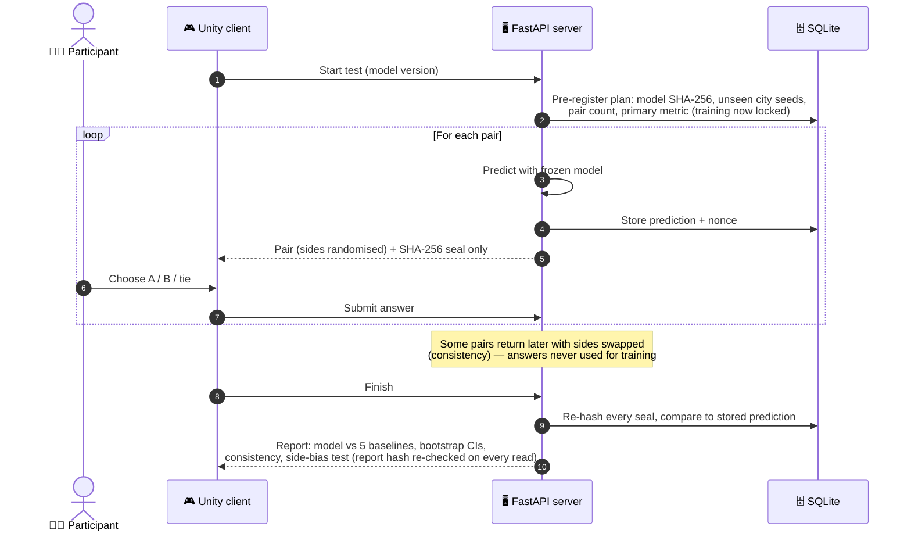

<p align="center">
  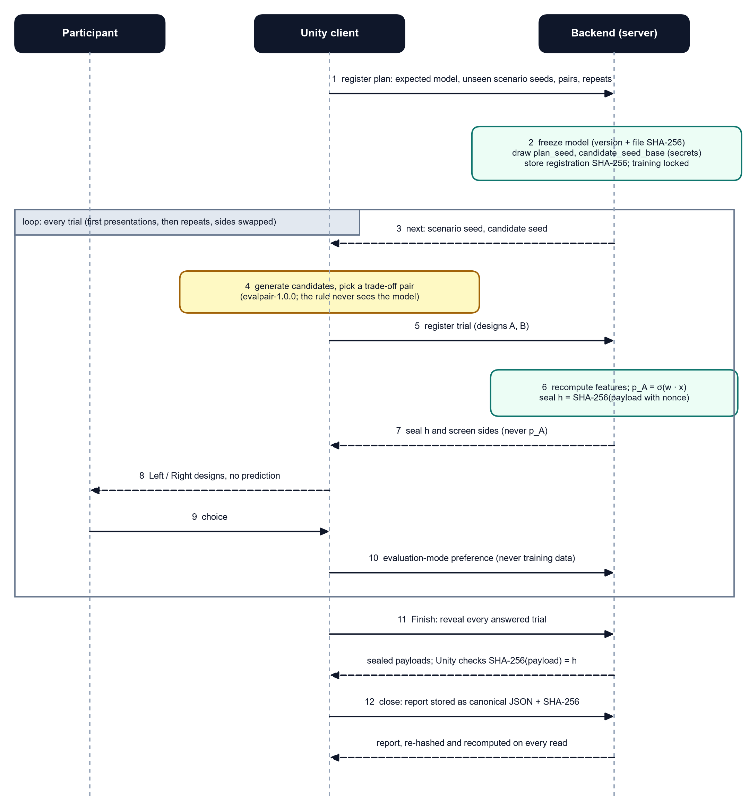<br>
  <sub>The full message-level protocol as drawn in the technical paper, including the secret seeds and the training lock.</sub>
</p>

| Safeguard | Purpose |
|---|---|
| Pre-registration (model hash, seeds, n, metric) | No moving the goalposts after seeing results |
| Unseen cities only | The server rejects any seed used in training or practice |
| SHA-256 seal with nonce, shown before the choice | The prediction cannot be changed or peeked at |
| Server-held randomisation seed | Left/right order cannot be predicted or gamed |
| Swapped repeats | Measures the participant's own consistency — the ceiling for any model |
| Training lock while a test is open | The model under test cannot change |
| Self-verifying, hashed report | Recomputed and checked on every read |
| Sealed exports hide unrevealed predictions | Exports taken mid-test cannot steer later answers |

---

## 📊 Results

> [!NOTE]
> **Data composition, stated plainly.** The active model was trained on **30 comparisons across
> 5 cities**: **10 made by the author** (seed 42) and **20 generated by a fixed rule** — *"prefer
> more park access, then lower cost"* — to complete the demo. Across the whole database, 35 of 61
> stored choices are rule-made and flagged as synthetic. The demo video's choices are scripted.
> These are **demonstration results from one participant**, not a study.

### Learned weights

Standardised weights with 90 % city-level bootstrap intervals (200 resamples):

| Feature | Weight | 90 % interval | Reading |
|---|---:|:---:|---|
| Park access | **2.69** | 2.13 to 2.93 | Strongest association; same sign in 100 % of resamples |
| Housing capacity | −0.60 | −1.17 to −0.05 | Associated with less housing |
| Park share of land | 0.10 | −0.43 to 1.10 | Little or no association |
| Low spending | −0.79 | −0.99 to −0.48 | Associated with *higher* cost — more access usually costs more |
| Keeping original housing | 0.47 | −0.18 to 0.97 | Direction uncertain |

<p align="center">
  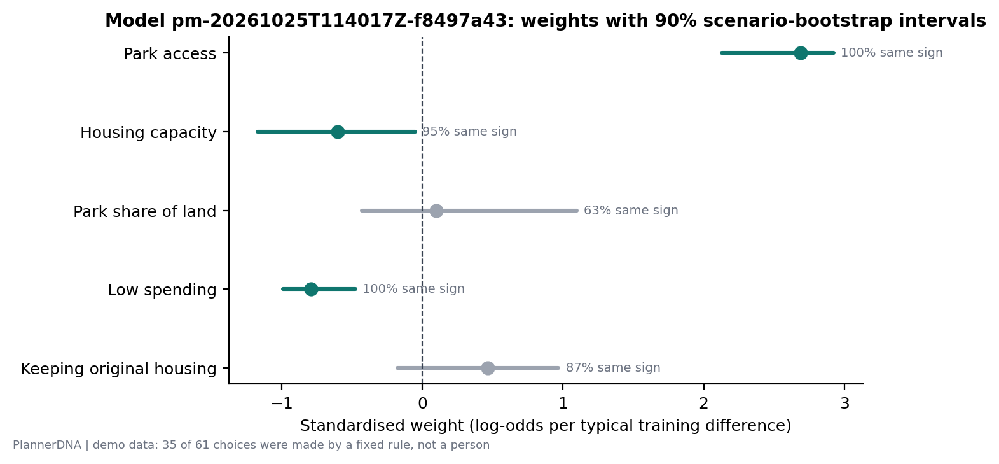
  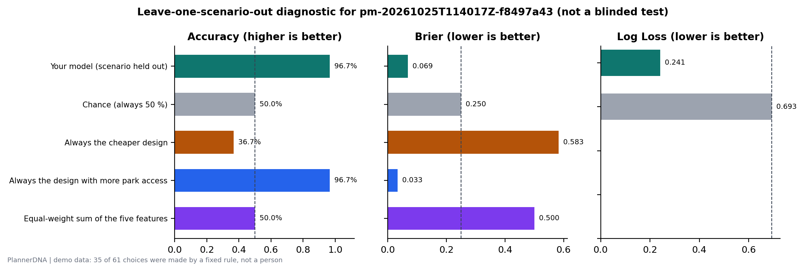
</p>

### Leave-one-city-out (inside the training data)

| Predictor | Accuracy | Note |
|---|---:|---|
| Pairwise model | **96.7 %** | Brier 0.069, log loss 0.241 |
| Always more park access | 96.7 % | Brier 0.033 — the rule that generated two thirds of the data |
| Chance | 50.0 % | |
| Equal-weight sum | 50.0 % | |
| Always the cheaper design | 36.7 % | |

This is a diagnostic, **not** a held-out test.

### Blinded test (author, unseen cities)

Pre-registered plan: 4 pairs in each of 3 unseen cities plus 3 swapped repeats. All 15 were
answered; 3 first presentations were ties, leaving **9 scored choices**. All 15 seals verified.

| Predictor | Accuracy | 95 % CI | Brier | Log loss |
|---|---:|:---:|---:|---:|
| **Frozen model** | **8 / 9 = 88.9 %** | 50–100 % | **0.111** | **0.661** |
| Always more park access | 88.9 % | 50–100 % | 0.111 | — |
| Always the design on the left | 66.7 % | 50–100 % | 0.333 | — |
| Chance | 50.0 % | — | 0.250 | 0.693 |
| Equal-weight sum | 44.4 % | 25–67 % | 0.556 | — |
| Always the cheaper design | 22.2 % | 0–50 % | 0.778 | — |

<sub>Rules give hard 0/1 predictions, so log loss is undefined for them.</sub>

| Check | Result |
|---|---|
| Model vs. *more park access* rule | Agree on **9 / 9** scored pairs — the model has not beaten its simplest rival |
| Participant consistency (swapped repeats) | 2 / 3 (Wilson 95 % interval 20.8–93.9 %) |
| Side bias | Chose left 7 / 12, binomial p = 0.774 (no evidence of bias) |
| Calibration | ECE 0.088 |
| Report integrity | All seals verified; report hash recomputed and matching |

A separate scripted agent playthrough of the blinded test scored 12 / 12; it is reported in the
figures with suffix `_1` and is **not** evidence about human preference.

<p align="center">
  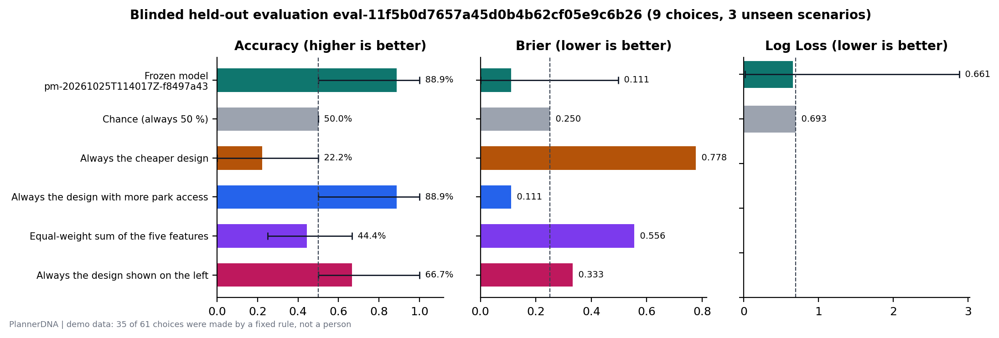
  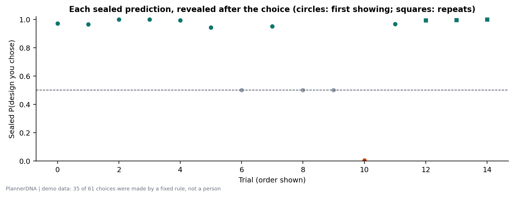
</p>
<p align="center">
  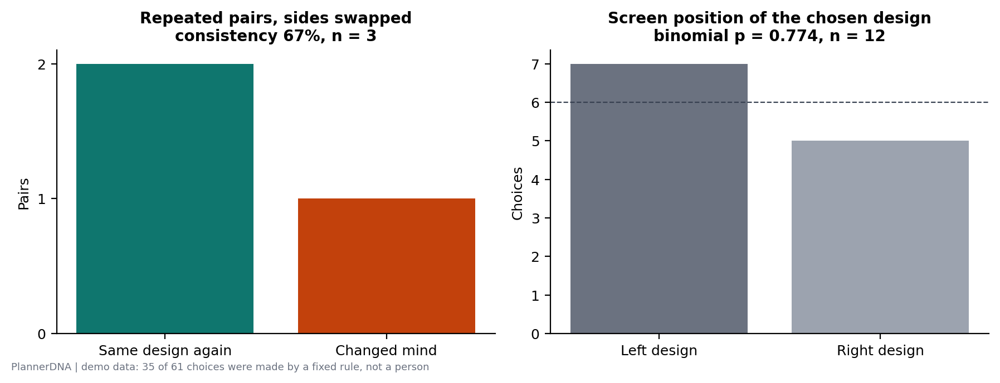
  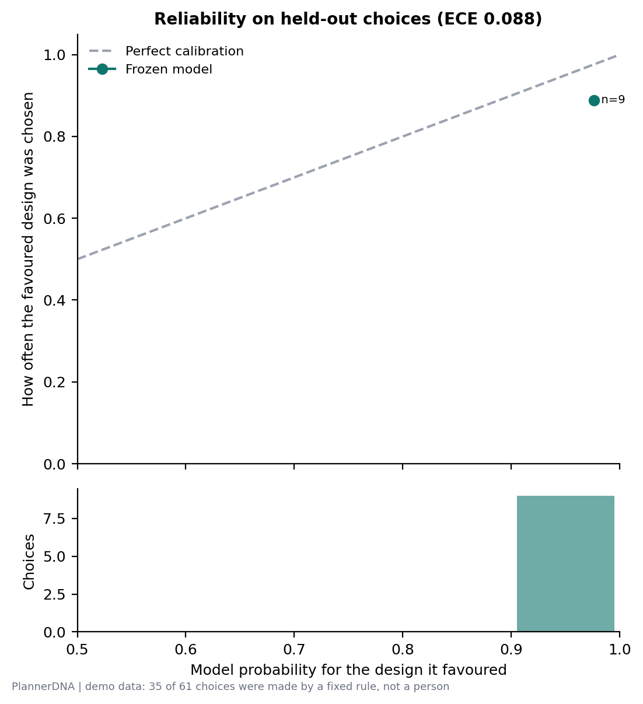
</p>

**Honest reading:** with 9 scored pairs the interval is wide, and the model's predictions are
identical to the *more park access* rule. The system works end-to-end and its claims are
auditable; whether it captures anything beyond that rule needs more human participants.

All figures (PNG, SVG, PDF and the CSV behind each) are in [`deliverables/figures/`](deliverables/figures)
with [`captions.md`](deliverables/figures/captions.md).

---

## 🛡️ Engineering and integrity

| Concern | How it is handled |
|---|---|
| **Trust boundary** | The backend never trusts Unity's numbers: it rebuilds each design from its snapshot, recomputes metrics, features and content hash, and refuses any mismatch. |
| **Determinism** | SplitMix64 generator with pinned reference values; identical data → identical model version id. |
| **Serialization safety** | Models are JSON with SHA-256 checksums; pickle is never used. |
| **Leakage control** | Blinded answers are never trained on; evaluation cities are disjoint from training; unrevealed predictions are hidden from exports. |
| **Offline resilience** | Unity keeps working without the backend and queues sync. |
| **Privacy** | Binds to `127.0.0.1` only; no accounts, analytics, cloud calls or telemetry. Personal data (`backend/data/`, backups, voice recordings) is excluded from this repository. |
| **Test isolation** | Tests use temporary databases and a throwaway backend; they never touch the real data. |
| **Reproducibility** | Pinned dependencies, seeded generators, versioned metrics (`metrics-1.0.0`), features (`features-v1`) and protocol (`blinded-eval-1.0.0`). |

---

## 🚀 Getting started

### Prerequisites

| Tool | Version |
|---|---|
| Unity Editor | **6000.6.7f1** (via Unity Hub) |
| Python | **3.12** |
| OS | Developed and tested on Windows 10/11 |

### 1. Backend

```powershell
cd backend
py -3.12 -m venv .venv
.\.venv\Scripts\python.exe -m pip install -r requirements.txt
.\.venv\Scripts\python.exe -m uvicorn app.main:app --host 127.0.0.1 --port 8765
```

Check it at <http://127.0.0.1:8765/health>. A fresh SQLite database is created in `backend/data/` on first run.

### 2. Unity

1. Open `PlannerDNA_Unity/PlannerDNA_Unity` in Unity Hub with **6000.6.7f1**.
2. Open `Assets/PlannerDNA/Scenes/PlannerDNA_Main.unity` and press **Play**.
3. Follow the Home screen and guided tour. The client works offline and syncs when the backend is up.

### 3. Figures and documents (optional)

```powershell
# Figures from a research export
cd backend
.\.venv\Scripts\python.exe -m pip install -r requirements-analysis.txt
.\.venv\Scripts\python.exe -m tools.make_figures --api http://127.0.0.1:8765 --out ..\figures

# Paper, carousel and video tooling
cd ..
py -3.12 -m venv .media-venv
.\.media-venv\Scripts\python.exe -m pip install -r tools\requirements.txt
.\.media-venv\Scripts\python.exe tools\make_paper.py --api http://127.0.0.1:8765   # backend must be running
```

Step-by-step guide for beginners: [`docs/START_HERE.md`](docs/START_HERE.md) · full command reference: [`docs/runbook.md`](docs/runbook.md)

---

## 🧪 Testing

| Suite | Count | Covers |
|---|---:|---|
| Backend · pytest | **88 passed** | Recomputation and tamper refusal, readiness refusals, model symmetry, LOSO isolation, artifact checksums, candidate verification, evaluation protocol, sealed export, figures |
| Unity · EditMode | **130 passed** | Generator reference values, metrics, walk distances, cost table, validator, undo/redo, candidate generator, local store |
| Unity · PlayMode | **24 passed** (+5 opt-in) | Offline play, live sync against a throwaway backend, Learning Lab training, a full blinded test |

```powershell
# Backend
cd backend; .\.venv\Scripts\python.exe -m pytest -v

# Unity (Editor closed)
$Unity   = "C:\Program Files\Unity\Hub\Editor\6000.6.7f1\Editor\Unity.exe"
$Project = "$PWD\PlannerDNA_Unity\PlannerDNA_Unity"
Start-Process $Unity -ArgumentList "-batchmode -projectPath `"$Project`" -runTests -testPlatform EditMode -testResults `"$PWD\TestResults\editmode.xml`"" -Wait
Start-Process $Unity -ArgumentList "-batchmode -projectPath `"$Project`" -runTests -testPlatform PlayMode -testResults `"$PWD\TestResults\playmode.xml`"" -Wait
```

---

## 🗂️ Repository layout

```text
PlannerDNA/
├── PlannerDNA_Unity/PlannerDNA_Unity/     Unity 6 project
│   ├── Assets/PlannerDNA/
│   │   ├── Scripts/                       Core (pure C#), city, editing, UI, networking, learning
│   │   ├── UI/                            UI Toolkit layout (UXML), theme and panel settings
│   │   ├── Scenes/                        PlannerDNA_Main.unity
│   │   ├── Fonts/                         Public Sans (OFL)
│   │   └── Tests/                         EditMode and PlayMode suites
│   ├── Packages/                          Package manifest
│   └── ProjectSettings/
├── backend/                               FastAPI + SQLite + scikit-learn
│   ├── app/                               API, migrations, verification, learning, evaluation
│   ├── tests/                             pytest suite (temporary databases only)
│   ├── tools/                             Figure generation from research exports
│   └── requirements*.txt                  Pinned dependencies
├── docs/                                  Architecture, data dictionary, ML protocol, runbook, limitations
│   ├── assets/                            README banner and preview
│   └── brief/                             Original project brief and beginner guide
├── tools/                                 Paper, carousel and video build scripts
└── deliverables/
    ├── video/                             Narrated demo, silent demo, poster
    ├── figures/                           Publication figures (PNG/SVG/PDF + CSV)
    ├── screenshots/                       1080p stills
    ├── paper_assets/                      Methodology diagrams and rendered equations
    ├── PlannerDNA_Technical_Paper.pdf/.docx
    ├── PlannerDNA_LinkedIn.pdf
    ├── PlannerDNA_Narration.md
    └── PlannerDNA_System_Overview.md
```

---

## 📚 Documentation and deliverables

| | Document | Description |
|---|---|---|
| 🎬 | [`video/PlannerDNA.mp4`](deliverables/video/PlannerDNA.mp4) | Narrated walkthrough, 1:57, 1920 × 1080 |
| 🎞️ | [`video/PlannerDNA_demo.mp4`](deliverables/video/PlannerDNA_demo.mp4) | The same walkthrough without narration |
| 📄 | [`PlannerDNA_Technical_Paper.pdf`](deliverables/PlannerDNA_Technical_Paper.pdf) · [`.docx`](deliverables/PlannerDNA_Technical_Paper.docx) | Full research paper: methodology diagrams, equations, results, 43 references |
| 🗒️ | [`PlannerDNA_System_Overview.md`](deliverables/PlannerDNA_System_Overview.md) | Everything about the system in one file |
| 🎙️ | [`PlannerDNA_Narration.md`](deliverables/PlannerDNA_Narration.md) | Timed narration script for the video |
| 🖼️ | [`PlannerDNA_LinkedIn.pdf`](deliverables/PlannerDNA_LinkedIn.pdf) | 11-page carousel summary |
| 🚪 | [`docs/START_HERE.md`](docs/START_HERE.md) | Beginner setup guide |
| 🏗️ | [`docs/architecture.md`](docs/architecture.md) | Components, data flow, trust boundary |
| 🗃️ | [`docs/data-dictionary.md`](docs/data-dictionary.md) | Every table and field |
| 📐 | [`docs/scenario-and-metrics.md`](docs/scenario-and-metrics.md) | Scenario, metric formulas, cost table |
| 🧠 | [`docs/ml-protocol.md`](docs/ml-protocol.md) | Model, readiness, bootstrap, LOSO, blinded protocol |
| ⚠️ | [`docs/research-limitations.md`](docs/research-limitations.md) | What the results can and cannot support |
| 🛠️ | [`docs/runbook.md`](docs/runbook.md) | Commands for running, testing and troubleshooting |

---

## ⚖️ Limitations and ethics

- **Small, mixed data.** One participant; two thirds of the training comparisons are rule-made. No population-level claim is made.
- **Associations, not values.** Weights summarise which feature differences co-occur with choices in the compared pairs. They are not motives, expertise or "planning DNA" in any literal sense.
- **A stylised city.** Metrics are proxies (capacity, not people; a 400 m road walk; a fixed cost table) on a synthetic grid.
- **Model vs. rule.** On the blinded test the model matches the *more park access* rule on every scored pair.
- **Suggestions are not plans.** They are seeded synthetic candidates ranked by the model — never optimal or recommended designs.
- **Privacy by design.** Everything runs locally; no data leaves the machine. Personal data is not part of this repository.

Full discussion: [`docs/research-limitations.md`](docs/research-limitations.md) and Section 11 of the paper.

---

## 📝 Citation

If you use or refer to this work, please cite it (see also [`CITATION.cff`](CITATION.cff)):

```bibtex
@software{plannerdna_2026,
  author  = {Alpha},
  title   = {{PlannerDNA}: Learning and Blind-Testing Personal Pairwise Preference
             Models in a Local-First 3D Urban-Design Sandbox},
  year    = {2026},
  version = {1.0.0},
  url     = {https://github.com/sandaru01-IH/PlannerDNA}
}
```

---

## 🙏 Acknowledgements

- [Unity](https://unity.com/), [FastAPI](https://fastapi.tiangolo.com/), [SQLite](https://www.sqlite.org/),
  [scikit-learn](https://scikit-learn.org/), [NumPy](https://numpy.org/), [SciPy](https://scipy.org/),
  [matplotlib](https://matplotlib.org/), [ReportLab](https://www.reportlab.com/) and
  [python-docx](https://python-docx.readthedocs.io/).
- [Public Sans](https://public-sans.digital.gov/) typeface, SIL Open Font License 1.1.
- The pairwise model follows Bradley and Terry (1952); the evaluation design draws on
  pre-registration practice. Full references are in the paper.
- Parts of the code and documentation were developed with AI coding assistance; all results were
  produced by the system itself and are reported as measured.

<div align="center">
<br>
<sub>No license has been chosen yet, so all rights are reserved by default. Open an issue to ask about reuse.</sub>
</div>
