# PlannerDNA figures

Source: `http://127.0.0.1:8765/api/v1/export`, exported 2026-10-25T11:58:44.044183+00:00.

**35 of 61 comparisons carry synthetic test-fixture labels (stated in each figure footer).**

## fig01_training_data: Training data per scenario

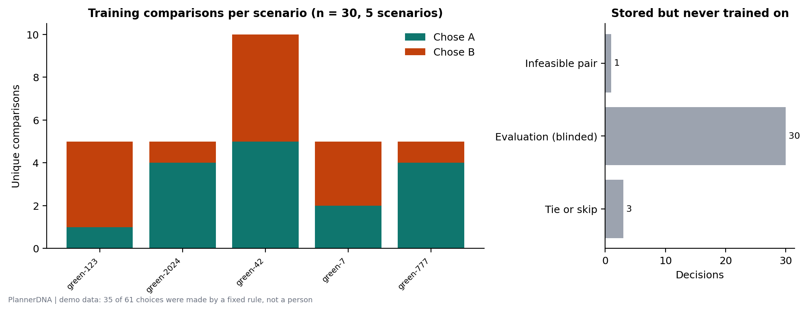

Training-eligible comparisons (explicit A/B choices between two feasible designs, train mode) per synthetic scenario: 30 comparisons across 5 scenarios. Right: stored decisions excluded from training (tie or skip: 3, evaluation (blinded): 30, infeasible pair: 1).

Data: `fig01_training_data.csv`

## fig02_tradeoff_space: Trade-offs in the choices

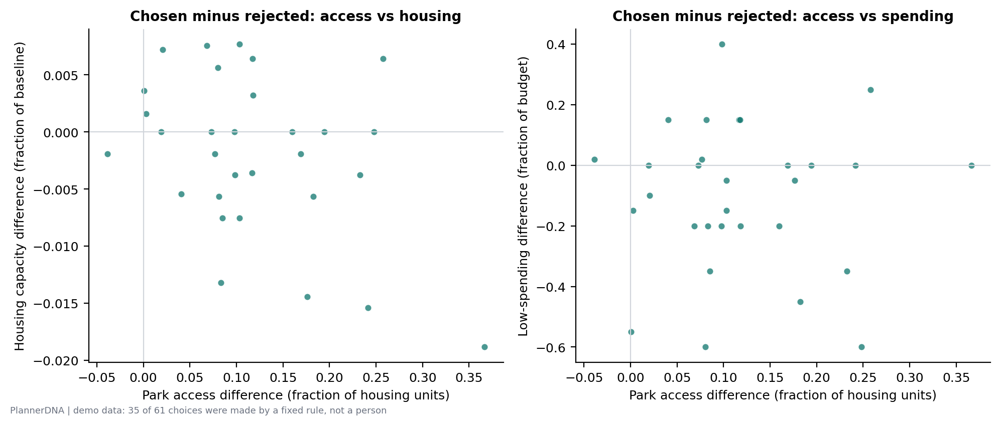

Each point is one training comparison, oriented as the chosen design minus the rejected one. Points right of zero chose more park access. In 14 comparison(s) more access was chosen at the cost of housing capacity; in 0 housing was chosen at the cost of access.

Data: `fig02_tradeoff_space.csv`

## fig03_coefficients: Fitted weights with uncertainty

Standardised weights of the pairwise logistic model pm-20261025T114017Z-f8497a43 (trained on 30 comparisons across 5 scenarios) with 90% percentile intervals from 200 scenario-bootstrap refits. Grey: interval includes zero or feature never varied. Weights are associations with explicit choices, not motives.

Data: `fig03_coefficients.csv`

## fig04_bootstrap_draws: Bootstrap distribution of weights

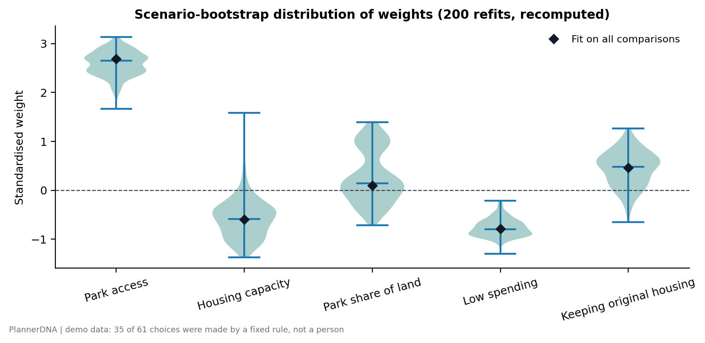

Distribution of standardised weights over 200 refits on scenario-resampled training data (seed 20261025, recomputed from the export with the backend's pairwise module). Diamonds: fit on all 30 comparisons. Wide or zero-straddling violins mean the direction is uncertain.

Data: `fig04_bootstrap_draws.csv`

## fig05_loso_vs_baselines: Cross-validated diagnostic versus baselines

Leave-one-scenario-out cross-validation inside the training data (5 folds, n = 30): the model scored accuracy 96.7%, Brier 0.069, log loss 0.241. Dashed lines: chance reference values (50%, 0.25, 0.693). Rule baselines are deterministic, so they have no log loss. This is a diagnostic, not the blinded evaluation.

Data: `fig05_loso_vs_baselines.csv`

## fig07_learning_curve: Learning curve

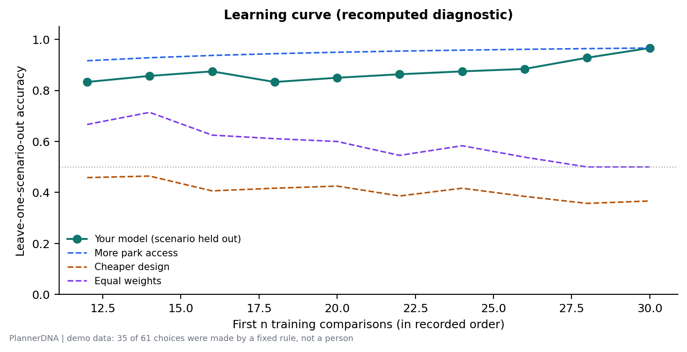

Leave-one-scenario-out accuracy when the model is fitted on only the first n training comparisons (recomputed from the export, n = 12 to 30), compared with fixed rules. Early points rest on few scenarios and are noisy.

Data: `fig07_learning_curve.csv`

## fig08_evaluation_vs_baselines_1: Blinded evaluation versus baselines

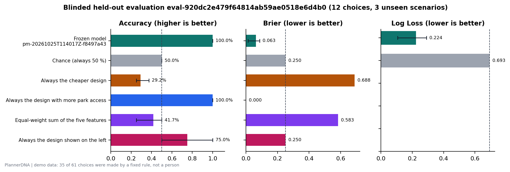

The frozen model pm-20261025T114017Z-f8497a43 predicted 12 of 12 held-out choices (100.0%) across 3 unseen scenario(s); 95% scenario-bootstrap interval 100.0% to 100.0%. Chance: 50.0%. Best simple rule: always the design with more park access 100.0%. Error bars: 95% scenario-clustered bootstrap intervals (1000 resamples) where at least three scenarios were scored. Predictions were sealed before each choice; evaluation choices were never used for training.

Data: `fig08_evaluation_vs_baselines_1.csv`

## fig09_model_minus_baselines_1: Model minus baselines

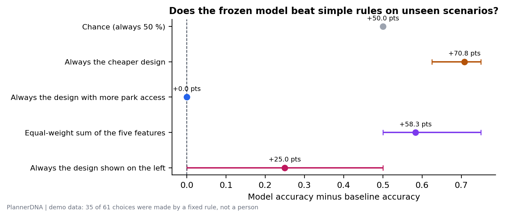

Paired accuracy difference between the frozen model and each baseline on the same held-out choices, with 95% scenario-clustered bootstrap intervals (when available). Intervals crossing zero mean no detectable difference.

Data: `fig09_model_minus_baselines_1.csv`

## fig10_calibration_1: Calibration of sealed predictions

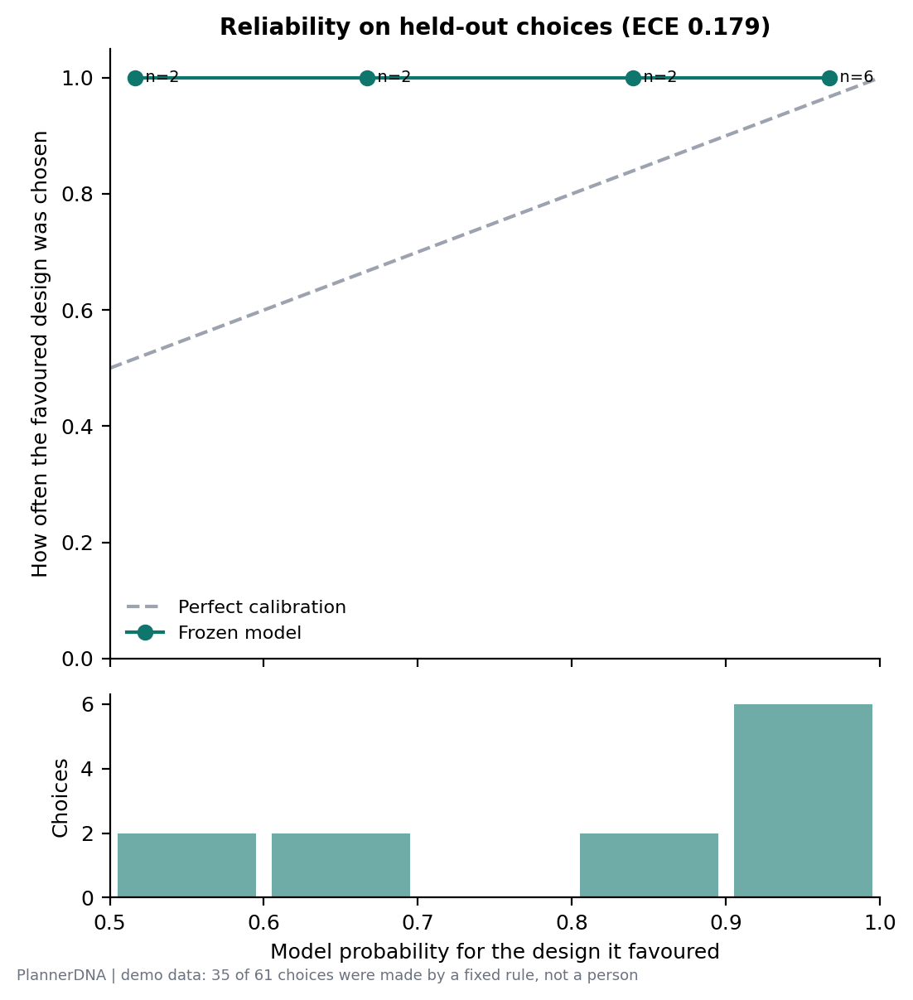

Reliability diagram for 12 scored held-out choices: sealed probability of the favoured design (x) against how often that design was chosen (y). Expected calibration error 0.179. Few choices per bin make this noisy.

Data: `fig10_calibration_1.csv`

## fig11_per_scenario_1: Per-scenario held-out accuracy

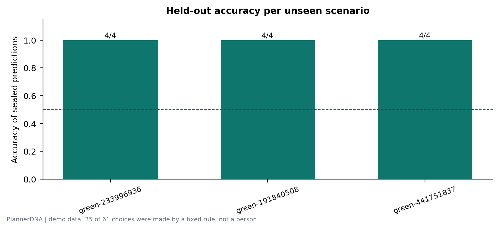

Accuracy of the frozen model's sealed predictions within each unseen evaluation scenario (labels: correct / scored). Variation between scenarios is why intervals resample whole scenarios.

Data: `fig11_per_scenario_1.csv`

## fig12_consistency_and_position_1: Choice consistency and position effect

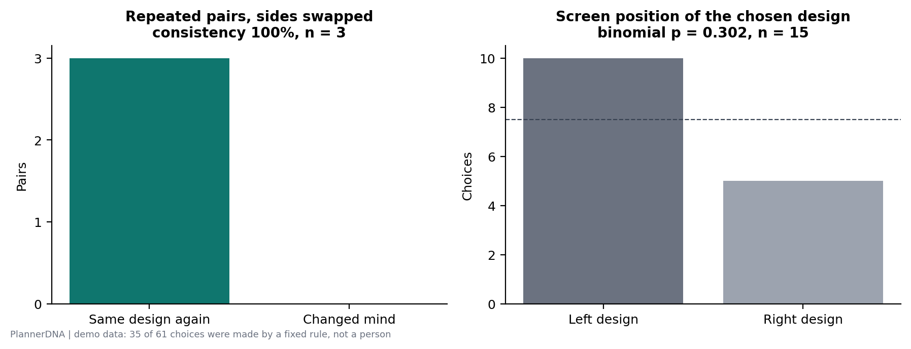

Left: of 3 pairs shown again later with sides swapped, the same design was chosen 3 time(s) (Wilson score interval, 95%: [43.9%, 100.0%]). Right: the left-hand design was chosen in 10 of 15 choices; the dashed line is an even split. Inconsistent choices cap any model's accuracy.

Data: `fig12_consistency_and_position_1.csv`

## fig13_sealed_predictions_1: Sealed predictions trial by trial

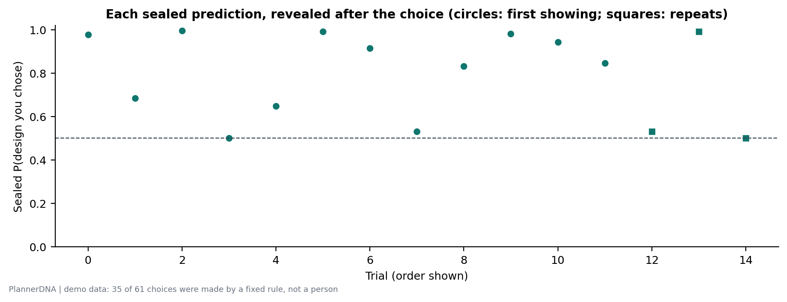

Probability the frozen model had sealed for the design that was then chosen, per trial. Above the dashed line the prediction matched (green); below it did not (orange); grey: tie or skip. Repeats (squares) are not scored.

Data: `fig13_sealed_predictions_1.csv`

## fig08_evaluation_vs_baselines_2: Blinded evaluation versus baselines

The frozen model pm-20261025T114017Z-f8497a43 predicted 8 of 9 held-out choices (88.9%) across 3 unseen scenario(s); 95% scenario-bootstrap interval 50.0% to 100.0%. Chance: 50.0%. Best simple rule: always the design with more park access 88.9%. Error bars: 95% scenario-clustered bootstrap intervals (1000 resamples) where at least three scenarios were scored. Predictions were sealed before each choice; evaluation choices were never used for training.

Data: `fig08_evaluation_vs_baselines_2.csv`

## fig09_model_minus_baselines_2: Model minus baselines

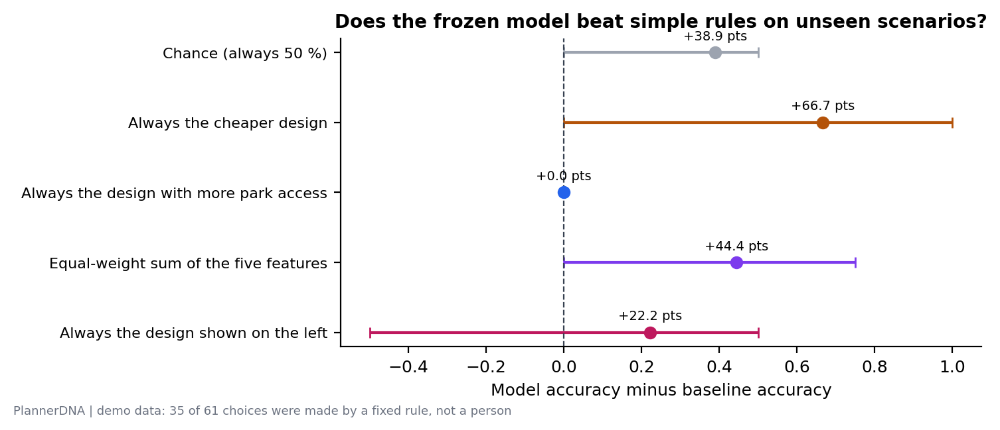

Paired accuracy difference between the frozen model and each baseline on the same held-out choices, with 95% scenario-clustered bootstrap intervals (when available). Intervals crossing zero mean no detectable difference.

Data: `fig09_model_minus_baselines_2.csv`

## fig10_calibration_2: Calibration of sealed predictions

Reliability diagram for 9 scored held-out choices: sealed probability of the favoured design (x) against how often that design was chosen (y). Expected calibration error 0.088. Few choices per bin make this noisy.

Data: `fig10_calibration_2.csv`

## fig11_per_scenario_2: Per-scenario held-out accuracy

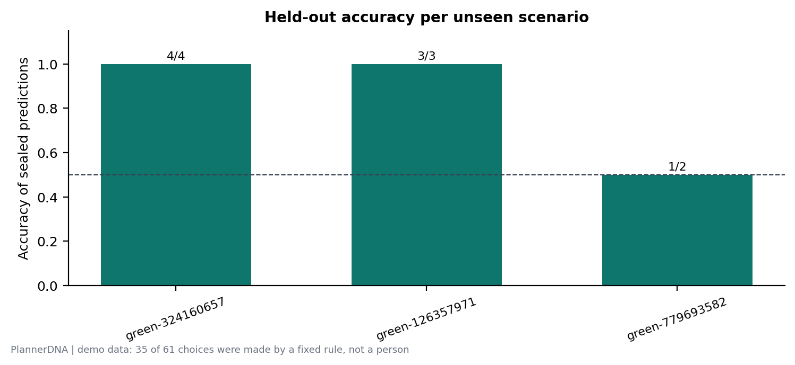

Accuracy of the frozen model's sealed predictions within each unseen evaluation scenario (labels: correct / scored). Variation between scenarios is why intervals resample whole scenarios.

Data: `fig11_per_scenario_2.csv`

## fig12_consistency_and_position_2: Choice consistency and position effect

Left: of 3 pairs shown again later with sides swapped, the same design was chosen 2 time(s) (Wilson score interval, 95%: [20.8%, 93.9%]). Right: the left-hand design was chosen in 7 of 12 choices; the dashed line is an even split. Inconsistent choices cap any model's accuracy.

Data: `fig12_consistency_and_position_2.csv`

## fig13_sealed_predictions_2: Sealed predictions trial by trial

Probability the frozen model had sealed for the design that was then chosen, per trial. Above the dashed line the prediction matched (green); below it did not (orange); grey: tie or skip. Repeats (squares) are not scored.

Data: `fig13_sealed_predictions_2.csv`

## Not generated

- `fig06_model_history`: Needs at least two trained model versions (export has 1).
