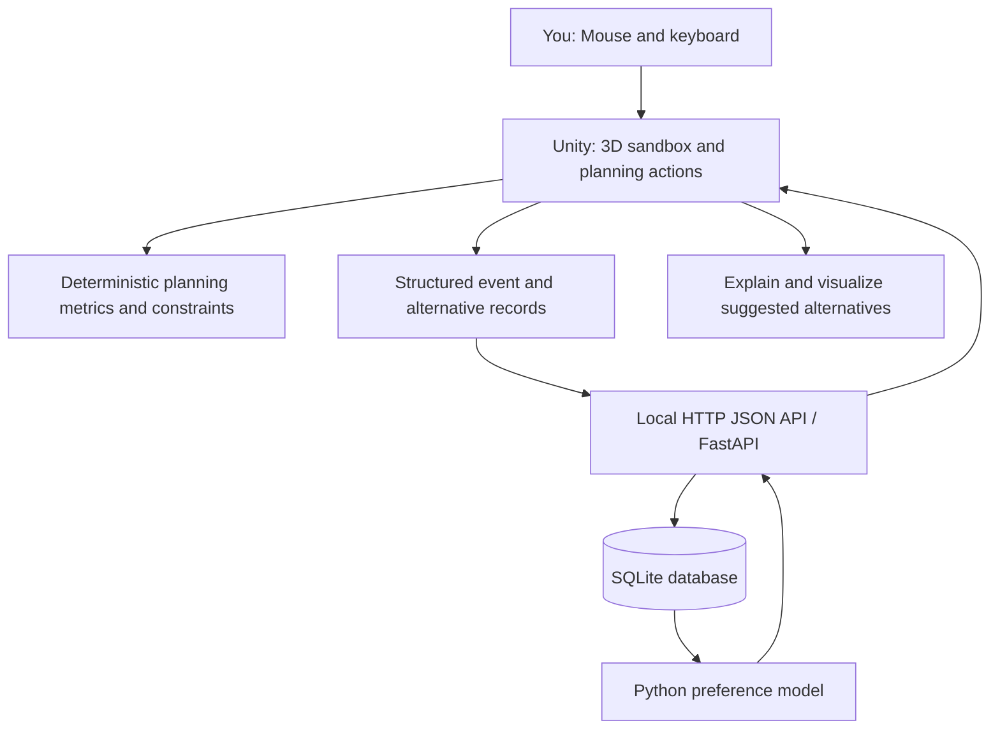

# PlannerDNA — Beginner's Technical Guide (Unity Edition)

**Audience:** One beginner developer who has Unity, Cursor, a capable Windows computer, and experience/interest in urban planning but does not yet know software engineering or ML.  
**Goal:** Understand every major component *before* writing code.  
**Product boundary:** Single-user, fully digital, local-first prototype. No cardboard, filmed public participants, DJI camera, online APIs, cloud GPU, GIS downloads, or paid services are required.

## 1. The big picture

PlannerDNA is an *interactive urban design experiment*, not an automatic master-planning authority. You edit synthetic neighbourhoods in Unity, save alternatives, make explicit pairwise choices, and use those choices to train a model that tries to predict your later preferences in *unseen* scenarios.

Think of three cooperating components:

- **Unity + C# = the city, rules, and interface.** Shows buildings, roads, and parks; lets you modify parcels; enforces constraints; computes deterministic metrics.
- **Python + FastAPI + scikit-learn = the learning service.** Receives alternatives and preferences, trains a model, makes predictions, measures error.
- **SQLite = your local research notebook.** Stores scenario seeds, action logs, complete design snapshots, comparisons, model versions, and tests.

Connection: Unity sends **JSON** over **HTTP** to `http://127.0.0.1:8765/api/v1`; Python responds with JSON. Localhost means the two programs talk on the same computer.



### Why Unity instead of a React/browser city?

Unity is the better choice for a full 3D camera, selecting objects, hover outlines, animations, city-building interactions, and later a simulation/game-style interface. Python is better for rapidly developing ML experiments and statistical evaluation. This is not a case where you need Unity ML-Agents from day one: ML-Agents generally trains autonomous agents in simulation; you initially need supervised learning from *your choices*.

### What your hardware does

The CPU renders scripts/logic and trains small statistical models; the GPU renders the 3D scene. For early models even a modest CPU is enough. More GPU does **not** solve the fundamental problem of having too few independent preference labels. An external DJI camera is optional for later gesture controls, not part of the learning mechanism.

## 2. Essential vocabulary (plain English)

| Term | Meaning in this project |
|---|---|
| Unity Project | The folder holding a game/application's assets, scripts and settings. |
| Unity Scene | A saved arrangement of cameras, lights, UI, and objects (your city screen). |
| GameObject | A visible/interactive object such as a building or tile. |
| C# Script | Instructions that control the Unity application. |
| Prefab | A reusable template, such as a building block. |
| Grid/Cell | A logical address such as `(row=4, column=7)` with a land-use type. |
| State | All the information that defines the city at one moment. |
| Action/Command | An intentional planning edit, for example, `RaiseBuilding` at cell 12. |
| Constraint | A hard rule, such as maximum 8 floors or budget ≤ 100 credits. |
| Metric | A calculated outcome: housing units, access %, budget usage. |
| Snapshot | A complete saved copy of a city's logical state. |
| Feature | A numeric model input describing an alternative's outcomes. |
| Label | The answer you supply: Design A preferred to Design B. |
| Train | Estimate model parameters from previous labelled comparisons. |
| Inference | Use an already-trained model to predict an unfamiliar pair. |
| Validation | Check whether the product and metrics operate as designed. |
| Held-out test | Later scenarios never used to fit or select the model. |
| API | A documented way one program requests information from another. |
| JSON | A common text format for structured data, with keys and values. |
| Database | Organized records; SQLite is one local file managed by Python. |
| Causality | Whether changing one thing actually causes another; choice correlations do not prove it. |

## 3. A complete scenario: The Green-Space Dilemma

**Environment:** A synthetic 20×20 grid. Each cell represents 40×40 metres, so the example neighbourhood covers 800×800 metres. This resolution is conceptual. One cell may represent a building parcel, park, road, or vacant land. Start with a fixed connected road grid and editable non-road parcels.

**Mission:** Increase the population-weighted share of residential capacity with network walking access to a park, while keeping total housing capacity at least 90% of baseline and intervention budget ≤ 100 *synthetic credits*. Maximum building height is 8 floors.

**What you see in Unity:**
1. An attractive, stylized 3D map, an orbitable camera, coloured land-use parcels and variable-height buildings.
2. A mission sidebar: current/baseline park access, housing units, park share, budget spent and constraint state.
3. A tool palette: Select, Add Park, Residential, Demolish, Height +/−, Undo, Redo, Save Alternative A/B, Compare.
4. A decision timeline and a mode to inspect the calculation behind any number.

**Example sequence (hypothetical values, not observed/validated planning outcomes):**
- You see several housing blocks far from existing parks.
- You convert one vacant parcel into park. Access rises, budget increases.
- You replace a residential building with a park. Access improves further but capacity falls.
- You increase floors on another permitted residential parcel to recover some capacity.
- You save this as **Alternative A**.
- You revert to the same initial neighbourhood, preserve more housing and create a smaller park nearer the road. Save as **Alternative B**.
- The app displays the two outcomes side by side under the *same baseline, rules and feature definitions*. You choose A, B, or Tie/Skip, and optionally give a reason.
- After several diverse scenarios and comparisons, you train the personal preference model.
- On a brand-new neighbourhood, the AI ranks a few feasible alternatives. You choose independently before viewing its preferred answer during evaluation mode.

**Crucial point:** A click on a green tile is *not* evidence you prioritize greenery. You may have been exploring or correcting an error. The strongest learning labels come from **explicit A/B comparisons**, not from inferred motives.

## 4. How the 3D scene connects to meaningful data

Every city cell must have **logical data**, independent of how it looks. Example:

```json
{
  "cell_id": "r05_c09",
  "row": 5,
  "column": 9,
  "land_use": "residential",
  "floors": 4,
  "units_per_floor": 4,
  "max_floors": 8,
  "editable": true
}
```

Unity draws a building with height proportional to `floors`, but the **logical CityState** is the source of truth; the mesh is only its visual representation. If a view is deleted or re-rendered, metrics must not change. If the same seed is loaded again, the same city and metrics must appear.

**Design rule:** Keep the `CityState`, `ActionValidator`, `ActionExecutor`, `MetricEngine`, `ScenarioGenerator`, `SnapshotManager`, and `WorldRenderer` as separate classes/modules. This is essential for testing.

### How to compute sample metrics

1. **Housing capacity (synthetic units):** Sum `floors × units_per_floor` over residential cells. Do not call this real population or housing demand.
2. **Park area share:** `park cells / non-road cells × 100`; the denominator is explicitly shown.
3. **Network park accessibility:** Construct a graph of connected road cells. A residential parcel is linked to an adjacent road; a park is linked to adjacent road cell(s). Use shortest path along roads plus a documented parcel-to-road entry distance. Mark parcels lacking access as inaccessible. A housing cell contributes `floors × units_per_floor` capacity as a weight; accessibility is a capacity-weighted share within a 400 m walk threshold. No Euclidean shortcut.
4. **Cost:** Compute from the **difference between the current city and the original baseline**, using a transparent cost table. A design that is changed and later fully undone must not permanently consume budget. Label all costs "synthetic credits".
5. **Violations:** Budget > limit, housing capacity < 90% of baseline, or floors > max. An invalid intermediate design may be allowed during exploration, but it cannot be compared as a *feasible AI recommendation*.

All calculations must be deterministic, versioned, and tested with small hand-worked examples. No claim of real-world traffic, heat, flood or economic impact without calibrated models.

## 5. One click, in slow motion

Suppose you click **Raise building** at cell `(5,9)`.

1. `InputController` detects mouse click and determines the selected grid cell by raycasting into the scene.
2. `ActionValidator` checks whether it is residential/commercial and is below the maximum floors.
3. `ActionExecutor` creates a new `CityState`, raising floors from 4 to 5. It does not directly mutate an arbitrary 3D object and hope the data stays in sync.
4. `MetricEngine` recalculates housing capacity, accessibility weights, cost and violations.
5. `WorldRenderer` updates that cell's building height and metric UI.
6. `CommandHistory` records an undoable edit. The data logger records a structured event: what, where, when, before, after, and metrics.
7. A local queue sends the event to Python. If Python is not running, save locally for later synchronized delivery rather than deleting the action or freezing Unity.

Example local event sent from Unity to the backend:

```json
{
  "event_id": "7b17f306-a534-448b-90e0-3d49a9e152ff",
  "session_id": "demo-session-01",
  "event_index": 12,
  "action_type": "raise_building",
  "source": "mouse",
  "cell_id": "r05_c09",
  "before": { "land_use": "residential", "floors": 4 },
  "after": { "land_use": "residential", "floors": 5 },
  "metrics_before": { "housing_units": 264 },
  "metrics_after": { "housing_units": 268 },
  "client_time_utc": "2026-10-25T03:00:00Z"
}
```

The numbers and timestamp are illustrative. The backend deduplicates repeated `event_id` values and respects `event_index` order.

## 6. How Unity and Python communicate

Unity uses a normal HTTP request, like posting a small form. For example:

**Request:** `POST http://127.0.0.1:8765/api/v1/preferences`

```json
{
  "comparison_id": "c-0001",
  "scenario_id": "green-001",
  "alternative_a_id": "alt-a-001",
  "alternative_b_id": "alt-b-001",
  "choice": "A",
  "reason": "better park access with acceptable housing trade-off",
  "phase": "training"
}
```

**Reply:** `{"saved": true, "comparison_id": "c-0001"}`

The Python program uses **FastAPI**, which also provides interactive API documentation at `http://127.0.0.1:8765/docs` while the service is running.

## 7. How personal preference learning works

### 7.1 First, define features

Each saved design needs the same types of measurable information, expressed as a normalized numeric vector. Example:

`f(design) = [park_access_gain, housing_change, park_area_change, negative_budget_fraction, negative_displacement]`

These are dimensionless values with a recorded scaling rule, not arbitrary changing numbers. The "negative" signs encode that *more* money spent/displacement is worse in those individual feature representations; the model still learns whether you care about them and by how much.

### 7.2 Then, learn from pairwise comparisons

If you chose A over B, the AI considers the **difference** between them:

`x = f(A) - f(B)`.

A regularized logistic model learns weights `w` so that:

`P(choose A rather than B) = 1 / (1 + exp(-w · x))`.

Example only: If you repeatedly select better park access despite a small capacity loss, the fitted park-access weight *may* become positive relative to other measured features. This is a **statistical pattern**, not evidence the model has read your mind or fully reconstructed your reasoning.

A symmetric pairwise model has no intercept; opposite comparison order should complement its prediction: `P(A>B) + P(B>A) = 1`. For stable fitting, store each real comparison as one independent record; internally one may augment training with its reversed row, but **never count the reversed row as an independent user choice**.

### 7.3 What training physically means

Python reads stored preference records, calculates feature differences for each comparison, and adjusts weights to minimize prediction error. It saves the resulting weight vector and a feature-schema version to disk. Later Unity submits two new feasible alternatives and gets back the estimated preference probability and a plain-language explanation of the measurable differences.

This first model is **real machine learning**, although it is not deep learning. Deep learning is not inherently stronger with a small, one-person dataset. Later, if you collect many decision sequences, you could investigate sequence prediction or imitation learning as separate experiments.

### 7.4 What about rejected actions and order?

Keep action order, undone actions, elapsed time and explored alternatives in the dataset. Do **not** initially treat an undo as proof an option is bad. Later sequence models can examine patterns, but those patterns may reflect navigation errors, experimentation or software usability—not stable planning preferences.

## 8. How the AI generates a proposed plan

1. Unity generates or receives a set of 10–50 candidate interventions through a **transparent rule-based search** (for example, add a park at an eligible parcel, upgrade a residential parcel up to the height cap, or combine a few edits).
2. Each candidate is simulated by **the same metric engine** used for your manual designs.
3. Remove candidates with any hard constraint violations and duplicates.
4. Extract feature vectors.
5. Pass candidate features to Python to rank using the learned utility score `w · f(candidate)`.
6. Return top diverse candidates with full metric changes and a prediction confidence warning.
7. Display these as suggestions, not as guaranteed optimum plans.

**Separation of responsibility:** The constraint/simulation engine checks legality and calculates outcomes; the preference model estimates *which feasible outcome you tend to like*. It does not secretly rewrite the planning rules.

## 9. The research experiment, designed honestly

Your product can be valuable as a working software prototype with one user. For academic evaluation, use clear and limited claims.

**Research question:** Can a model fitted on a single person's pairwise choices predict their preferences on different synthetic urban planning scenarios better than simple baselines?

**Suggested feasibility study, not a power calculation:**
- Create 12–20 varied scenario seeds, with more if you can sustain genuine diversity.
- Collect about 60–100 meaningful A/B comparisons from *you*, across varied conditions and trade-offs, before interpreting model results. A smaller set is fine for testing the code but not persuasive evaluation.
- Split training and held-out testing **by entire scenario**. Do not split alternative pairs randomly within one neighbourhood.
- Lock the model before test trials. Ask for your choice first on each held-out pair, and reveal predictions afterward to avoid priming.
- Randomize A/B screen positions and log repeated choices occasionally to estimate decision consistency.
- Compare learned model against a chance model (0.5 on pairwise A/B), a simple rule (such as prefer lowest cost or best access), and a fixed equal-weight utility score.
- Report preference accuracy, log loss, Brier score, how many unique held-out scenarios, consistency on repeated trials, and uncertainty. Avoid impressive percentages on tiny test sets.
- Do not use test choices for training until the pre-registered assessment is completed. If later added to training, record a new model version and fresh test set.

**Limitations:** Your results cannot demonstrate that the model describes other planners, that its choices are normatively correct, or that it recovered your actual internal motivations. The preferences may drift over time. Synthetic constraints could also induce artificial patterns. To study causal effects of planning objectives, vary constraints systematically and control confounding.

## 10. What to install and how to connect tools on Windows

1. Use **Unity Hub** to install **Unity 6.3 LTS** (or a compatible installed Unity 6 LTS; lock its precise version once selected), Windows Build Support and your editor integration. Do not upgrade mid-project casually.
2. In Unity Hub choose a new **3D URP** project called `PlannerDNA_Unity`. Start with simple primitives, not a purchased city asset pack.
3. Install/configure **Cursor**. Open the *repository root* containing the Unity project and the Python backend; let Unity Hub open only the `PlannerDNA_Unity` subfolder.
4. In Unity Editor, set **Edit > Preferences > External Tools > External Script Editor** as appropriate. Cursor can edit the repository files directly regardless of which tool opens double-clicked C# scripts.
5. Install Python **3.11 or 3.12**, then create an isolated environment: `py -3.12 -m venv .venv` (adapt if Python 3.11 was installed); activate in PowerShell with `.venv\Scripts\Activate.ps1` and install backend requirements. If script execution is restricted, use `.venv\Scripts\python.exe` without activating.
6. Launch backend with `python -m uvicorn app.main:app --reload --port 8765 --host 127.0.0.1` from the backend folder.
7. Test `http://127.0.0.1:8765/docs`. Open the Unity project via Unity Hub and click **Play**. The UI should show connection status but stay playable when backend is offline.
8. Commit source to Git, including Unity scenes/assets, C# scripts, `.meta` files and Python source. **Exclude** Unity `Library/`, `Temp/`, `Obj/`, builds, `.venv/`, secrets and generated model/database files.

**Cursor and Unity are different programs:** Cursor creates/edits scripts and some Unity text assets. Unity must *import* them, compile C#, wire the scene, and run the application. A Cursor message saying "implemented" is not proof the Unity app works. Inspect Unity Console for errors and test Play mode after every stage.

## 11. Development milestones / acceptance gates

**Phase 0 — Wiring:** Unity opens; backend `/health` works; Unity can display Online/Offline status; manual launch instructions exist.

**Phase 1 — Playable sandbox:** Deterministic 20×20 world; mouse selection; edit/respec/undo/redo; 3 meaningful metrics; mission constraints; A/B save/compare; no backend required for play. Test invalid actions.

**Phase 2 — Research logging:** Event queue; SQLite migrations; sessions; alternative snapshots; preferences; restarts and exports; no lost data during backend outage.

**Phase 3 — Actual model:** Pairwise logistic preference learning; explicit training button; versioned models; predictions using unseen alternatives; readable coefficient/uncertainty display; no fake AI.

**Phase 4 — Evaluation:** Held-out scenario protocol, blinded predictions, repeat-choice consistency, baselines, exportable study report.

**Phase 5 — Optional:** Auto-generated candidate plans, active comparisons, sequence modelling, gestures with your camera, richer scenarios, and eventually calibrated external datasets.

## 12. Errors and mistakes to avoid

- Creating an attractive city where the underlying metrics do not correspond to actual edits.
- Calling an output "learned preferences" when it uses hardcoded weights.
- Feeding the 3D screenshot into an expensive neural net when structured parcel data is available.
- Randomly splitting preference pairs from the same scenario into train/test; this leaks scenario information.
- Inferring emotional states, reasoning, personality, or expertise from screen clicks.
- Making city edits depend on an available Python backend.
- Installing Unity ML-Agents, Sentis/Inference Engine, or a large LLM before a small supervised baseline works.
- Calling a heuristic access index a real-world measured accessibility indicator.
- Claiming cause-and-effect from observational choices alone.
- Training only on the same few arrangements; a model may memorize the neighbourhood rather than generalize the underlying trade-offs.

## 13. Official reading links

- Unity 6 LTS: https://unity.com/releases/unity-6/support
- Unity UI Toolkit: https://docs.unity3d.com/6000.0/Documentation/Manual/UIElements.html
- Unity ML-Agents (later): https://unity-technologies.github.io/ml-agents/
- FastAPI request bodies: https://fastapi.tiangolo.com/tutorial/body/
- scikit-learn logistic regression: https://scikit-learn.org/stable/modules/generated/sklearn.linear_model.LogisticRegression.html

**Takeaway:** First make a transparent city simulator, then collect *your real explicit preferences*, then fit a tiny model and honestly test whether it predicts choices on new synthetic planning problems. That is the scientifically useful core of PlannerDNA.
